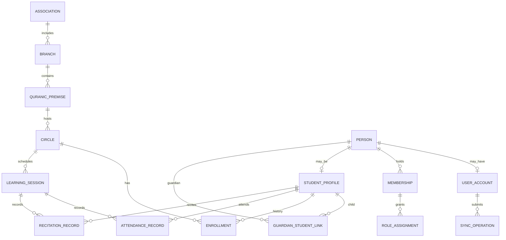

# أساس قاعدة البيانات والمزامنة دون إنترنت — نظام راسخ

**الحالة:** مسودة تصميم للمراجعة، وليست ترحيل SQL نهائيًا.  
**التاريخ:** 22 نوفمبر 2026

هذه الوثيقة تحول القرارات المعتمدة إلى أساس تقني قابل للبناء. لا تُعدّل الدستور ولا تستبدل أحكامه. وأي نقطة غير محسومة مذكورة أدناه تبقى مفتوحة حتى اعتمادها.

## 1. القرارات التي نبني عليها

- راسخ موقع يعمل في المتصفح، بواجهة متجاوبة للجوال والكمبيوتر والآيباد.
- الباك إند: Node.js وTypeScript وFastify، وقاعدة البيانات: PostgreSQL. يبدأ النظام كتطبيق واحد مقسّم إلى وحدات واضحة.
- التسلسل الإداري والتعليمي: راسخ ← الجمعية ← الفرع ← **المقر القرآني** ← الحلقة ← الطالب.
- المقر القرآني هو المسجد نفسه ضمن النظام، ويُعرض بالاسم والوصف المعتمدين. لا ننشئ كيانًا منفصلًا للمسجد أو نكرر المسجد والمقر القرآني كسجلين.
- الشخص له هوية واحدة، وقد تكون له عضويات وأدوار متعددة. الطالب لا يملك حساب دخول في الإصدار الأول، وولي الأمر حساب مستقل محدود بأبنائه المرتبطين به.
- المعلم يستطيع حفظ الحضور والتسميع أثناء انقطاع الإنترنت، ثم مزامنتهما بعد عودة الاتصال.
- الأسرار وبيانات الاتصال بقاعدة البيانات تبقى خارج GitHub، ولا تُرفع ملفات `.env`.

## 2. ما هو موجود الآن وما ليس موجودًا

النسخة الرئيسية في GitHub تحتوي واجهة تجريبية تحفظ بعض البيانات في المتصفح. تأسيس الباك إند موجود في طلب دمج مفتوح، ويتضمن خدمة Fastify واتصال PostgreSQL وفحوص الصحة والجاهزية. اختُبر محليًا ردّ الخدمة واتصال قاعدة البيانات.

حتى الآن لا توجد في النسخة الرئيسية جداول أعمال أو ترحيلات SQL أو دخول حقيقي أو صلاحيات متعددة الجهات أو مزامنة دون إنترنت. لذلك لن نتعامل مع واجهة التجربة أو اتصال PostgreSQL المحلي على أنهما النظام المنتج.

## 3. خريطة البيانات الأولية

هذه خريطة مفاهيمية قبل كتابة SQL. أسماء الجداول النهائية والحقول والقيود تأتي بعد مطابقة كل كيان مع الدستور وتفاصيل الصلاحيات.

| المجال | ما يجب أن تمثله البيانات |
|---|---|
| الهيكل | الجمعيات، الفروع، المقرات القرآنية، الحلقات. الحلقة تتبع المقر القرآني، وليس الفرع مباشرة. |
| الهوية والعضوية | الأشخاص، حسابات الدخول، عضويات الشخص في الجهات، الأدوار ونطاق كل دور. فصل الشخص عن حسابه وعن عضويته يمنع تكرار الهوية عند تعدد العضويات. |
| الطلاب والأسر | ملف الطالب، تسجيله وانتقاله بين الحلقات مع حفظ التاريخ، وربط ولي الأمر بأبنائه. لا يُمنح الطالب حسابًا في الإصدار الأول. |
| التعليم | جلسات الحضور وسجلاته، وسجلات التسميع والتقييم وفق القواعد التعليمية المعتمدة. تُحفظ التصحيحات والتغييرات في سجل تدقيق. |
| المزامنة | تعريف تثبيت/جهاز المتصفح عند الحاجة، ومعرّف فريد لكل عملية محلية، وحالة المزامنة ووقت الاستلام ونتيجة المعالجة. |

### العلاقات المقترحة — رسم أولي

الرسم يوضح اتجاه العلاقات فقط، ولا يفرض أسماء الجداول النهائية أو أعمدتها:

- لا يوجد كيان مستقل باسم «مركز» أو جدول منفصل للمسجد؛ الكيان هو المقر القرآني.
- انتقال الطالب بين الحلقات يُسجل كفترات تسجيل تاريخية، لا بتغيير صامت يمحو الحلقة السابقة.
- تُراجع علاقة سجلات التسميع بجلسات الحلقة وقواعد التقييم قبل تثبيت الأعمدة والقيود.

### قواعد سلامة البيانات

- لكل سجل نطاق جهة واضح؛ ويُشتق نطاق الوصول من عضوية المستخدم وصلاحياته على الخادم، لا من قيمة يرسلها المتصفح وحده.
- تمنع المفاتيح والقيود إنشاء علاقة بين سجلين من جهتين مختلفتين.
- لا نمحو انتقال الطالب أو تغيير العضوية كأنه لم يحدث؛ نحفظ فترة السريان وسجل التغيير.
- لا نكرر المسجد والمقر القرآني بجدولين منفصلين.
- لا نُسقط بيانات الحضور أو التسميع عند التعارض؛ نحتفظ بالعملية ونظهرها للمراجعة بدل أن تفوز آخر كتابة بصمت.

## 4. طريقة العمل دون إنترنت

1. يحمّل المتصفح واجهة النظام، ويخزن الحد الأدنى اللازم للعمل المصرح به، مثل قائمة طلاب الحلقة المعيّنة للمعلم. تُستخدم قاعدة المتصفح المحلية **IndexedDB** لطابور العمليات؛ لا يُعتمد على `localStorage` كسجل مزامنة.
2. يسجل المعلم الحضور أو التسميع، ويُنشأ للعمل معرّف فريد على الجهاز. يظهر له بوضوح أنه «بانتظار المزامنة» وليس محفوظًا على الخادم بعد.
3. عند عودة الاتصال، يرسل المتصفح العمليات على دفعات. يتأكد الخادم من المستخدم والعضوية والنطاق والقواعد التعليمية، ثم يحفظ المقبول ويعيد إقرارًا بمعرّف العملية.
4. يمنع الخادم تكرار العملية إذا أعاد المتصفح إرسالها بسبب انقطاع أو انتهاء مهلة. يعاد الإقرار نفسه بدل إنشاء سجل ثانٍ.
5. تبقى العمليات المرفوضة أو المتعارضة محفوظة محليًا مع سبب واضح حتى تُراجع؛ لا تُحذف بصمت.
6. تحفظ سجلات الحضور والتسميع كوقائع قابلة للتدقيق. التصحيح يكون بتغيير مسجل أو سجل تصحيح مرتبط، لا باستبدال غير مرئي يمحو ما سبق.

تظل الخادم وقاعدة البيانات المرجع النهائي. التحقق المحلي يساعد المعلم على العمل، لكنه لا يمنح صلاحية جديدة ولا يتجاوز إلغاء عضوية أو صلاحية. وإذا أُلغيت صلاحية المستخدم قبل المزامنة، يرفض الخادم العملية أو يحيلها للمراجعة وفق السياسة المعتمدة.

## 5. ما يتطلب حسمًا قبل تثبيت الترحيلات

لا يمنع هذا من إعداد الخريطة؛ لكنه يمنع اختراع قواعد أعمال نهائية:

1. **مصفوفة الصلاحيات التفصيلية:** الدور، الفعل، ونطاقه الإداري والتعليمي.
2. **سياسة التصحيح والتعارض دون إنترنت:** كيف يُراجع تسجيلان مختلفان للطالب نفسه والجلسة نفسها، ومن يملك اعتماد التصحيح.
3. **إغلاق الأسبوع والتسجيل المتأخر:** ما الذي يقفل، ومن يستطيع فتحه أو تعديل سجل بعد الإغلاق.
4. **الاستضافة والخصوصية:** اختيار مزود وموقع استضافة، ومدد الاحتفاظ والحذف والنسخ الاحتياطي ومتطلبات حماية البيانات.
5. **طريقة التحقق من الهوية:** إذا احتاج الدخول إلى رمز جوال أو بريد، يُختار مزودها قبل الإنتاج.

## 6. مراحل التنفيذ المقترحة

1. اعتماد قاموس الكيانات ومصفوفة الصلاحيات ومبادئ التعارض والمزامنة.
2. رسم العلاقات والقيود ومراجعة عزل بيانات الجمعيات والفروع.
3. إنشاء ترحيلات PostgreSQL صغيرة ومتسلسلة، بدءًا بالهوية والهيكل والعضويات، ثم الطلاب والأسر، ثم السجلات التعليمية والمزامنة.
4. بناء واجهات الباك إند والتحقق والصلاحيات وتدقيق التغييرات.
5. ربط الواجهة المتجاوبة بالـAPI، ثم إضافة التخزين المحلي وطابور المزامنة.
6. التحقق من إعادة المحاولة بلا تكرار، ورفض البيانات خارج النطاق، واستعادة نسخة احتياطية قبل الإطلاق.

## 7. شروط اعتبار الأساس صالحًا للبناء

- لا يستطيع مستخدم في جمعية الاطلاع على بيانات جمعية أخرى، حتى بتغيير معرّف الطلب يدويًا.
- تظهر بيانات ولي الأمر لأبنائه المرتبطين به فقط.
- يبقى تسجيل الحضور والتسميع بعد تحديث الصفحة أو إغلاقها أثناء الانقطاع، ثم يُزامن مرة واحدة دون تكرار.
- تظهر حالة كل عملية: بانتظار المزامنة، تمت، أو تحتاج مراجعة.
- لا يؤدي تعارض أو رفض إلى فقد البيانات المحلية بصمت.
- تبقى تغييرات انتقال الطالب وتصحيح السجلات قابلة للمراجعة التاريخية.

> **تنبيه التنفيذ:** لا نبدأ بترحيل SQL نهائي قبل مراجعة العلاقات والصلاحيات في هذه المسودة. هذا التوقف القصير في التصميم يحمي النظام من إعادة بناء الجداول بعد بدء تسجيل بيانات فعلية.
